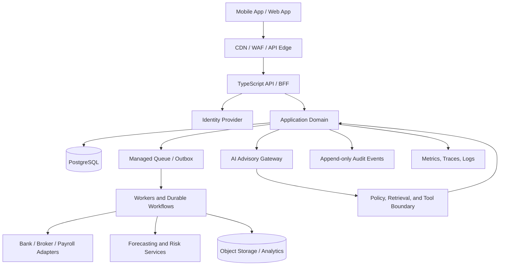

# SPFS Pro Architecture

This document describes the proposed target architecture and explains what should be built first. It is intentionally staged: a global product needs a coherent design, but should not pay the operational cost of every future component before it has real workloads.

## 1. Architecture goals

- Protect the confidentiality, integrity, and availability of highly sensitive financial data.
- Make calculations reproducible and auditable.
- Isolate AI-generated language from authoritative financial state and privileged execution.
- Support regional deployment, localization, provider differences, and jurisdiction-specific policy.
- Permit vendor replacement without rewriting core financial domains.
- Keep the initial system small enough for a small team to operate.
- Provide a credible path to higher scale through explicit domain boundaries, durable workflows, and regional cells.

## 2. System context

This is a logical view, not a claim that these components are deployed. For the first release, the application domain can be a modular monolith with background workers rather than many networked services.

## 3. Proposed technology stack

### Product surfaces
- **Mobile:** React Native + Expo + TypeScript.
- **Web:** Next.js + TypeScript.
- **API data fetching:** TanStack Query.
- **Local UI state:** use React state first; add Zustand only for genuinely shared client state.
- **Forms and validation:** React Hook Form plus shared schema validation where appropriate.
- **Testing:** Vitest/Jest as selected by the framework, Playwright for web end-to-end, and Maestro or equivalent for mobile journeys.
- **Accessibility:** platform semantics, keyboard support, screen-reader testing, contrast checks, text scaling, and reduced-motion support.

### API and domain logic
- **Initial API:** TypeScript + Fastify, Zod schemas, OpenAPI contracts.
- **Initial architecture:** modular monolith organized by domain, with explicit module interfaces and ownership.
- **Later money-critical services:** Kotlin + Spring Boot where independent deployment, stronger domain ownership, team boundaries, or workload isolation justify it.
- **Internal protocols:** REST/OpenAPI for external/public contracts. Use gRPC only when typed internal RPC has a measurable benefit.
- **Workflow orchestration:** begin with managed queues and idempotent workers. Adopt Temporal or an equivalent durable workflow engine when processes require long-running state, retries, timers, compensation, or human approval.
- **Money:** decimal-safe types, ISO currency codes, explicit rounding policy, idempotency, and invariant checks.

### Data stores
- **System of record:** managed PostgreSQL.
- **Cache:** managed Redis-compatible service only for ephemeral/cached data; never the sole source of financial truth.
- **Documents and raw imports:** encrypted object storage with retention and access policies.
- **Analytics:** start with scheduled exports and a warehouse or query engine; consider Parquet/Iceberg and ClickHouse as volumes and query patterns require.
- **Vector retrieval:** begin with metadata-filtered Postgres/pgvector if semantic retrieval is justified. Do not add a separate vector database without benchmarked need.

### Eventing
- Start with a **transactional outbox** and managed queue. Publish events only after the database transaction commits; consumers must be idempotent.
- Adopt Kafka when throughput, replay, fan-out, ordering, and operational maturity make it worthwhile.
- Use CDC (for example, Debezium) only when there is a clear need and the team can operate it safely.
- Define event schemas, versioning, ownership, retention, and personally identifiable information (PII) rules before broad event distribution.

### AI and quantitative intelligence
- **Python** for forecasting, statistical modelling, portfolio analytics, and model evaluation.
- **FastAPI** for separately deployed model endpoints when required.
- **LLM gateway:** provider-neutral interface with approved model routing, structured output validation, timeouts, budget controls, and redaction rules.
- **Retrieval:** access-controlled retrieval over explicitly permitted records and approved knowledge sources; enforce authorization before retrieval, not merely in the prompt.
- **Evaluation:** versioned datasets, regression tests, calibration/forecast metrics, groundedness tests, prompt-injection tests, and human review for high-impact use cases.
- **Model registry/feature store:** add MLflow/Feast when production model count and feature reuse justify the operational cost.

AI is an advisory interface, not the ledger or policy engine. A model must not independently determine an authoritative balance, invent tax rules, or directly execute transfers or trades.

### Cloud and operations
- **Reference cloud:** AWS, with managed services preferred.
- **Runtime:** begin with managed application/container services appropriate to the team's skills; use EKS only when Kubernetes provides clear operational value.
- **Regional strategy:** select a home region per user/tenant based on product availability, legal obligations, and provider coverage. Design cells as independently deployable units when the product reaches the scale or risk profile that justifies them.
- **Infrastructure as code:** Terraform.
- **CI/CD:** GitHub Actions, protected branches, staged environments, dependency scanning, secret scanning, and artifact provenance where practical.
- **Observability:** OpenTelemetry instrumentation and a managed logs/metrics/traces backend.
- **Feature controls:** server-side feature flags with kill switches for high-risk capabilities.
- **Secrets and keys:** managed secret storage and KMS/HSM-backed key management as appropriate.

## 4. Domain boundaries

Treat these as logical modules first. Promote modules to separate services only when ownership, scaling, security, or availability requirements demand it.

1. **Identity and consent:** user identity references, sessions, MFA/passkeys, consent grants, revocation.
2. **Financial connections:** provider authorization references, sync cursors, connection health, provider-specific adapters.
3. **Accounts and balances:** normalized account metadata and dated balance observations, including source and freshness.
4. **Transactions:** imported raw records, normalized transactions, categorization, deduplication, correction history.
5. **Cash flow and budgets:** recurring obligations, expected income, forecasts, budget rules.
6. **Goals and planning:** user goals, assumptions, scenario calculations, plan versions.
7. **Portfolio insights:** holdings and market-data provenance, exposure/fees/diversification analysis; no trade execution in initial scope.
8. **Tax support:** jurisdiction and tax-year scoped estimates/checklists, sourced rule versions, review status.
9. **Advisor orchestration:** context assembly, retrieval, tool registry, output validation, explanation and citations.
10. **Notifications:** preferences, templates, delivery attempts, quiet hours, deduplication.
11. **Audit and governance:** sensitive-action records, consent history, model/provider metadata, access events.
12. **Billing and entitlements:** subscription state and feature entitlements, isolated from financial account balances.

Every module should declare its data owner, public interface, authorization rules, events, retention requirements, and failure behavior.

## 5. Financial data and correctness

### Data model principles
- Store amounts as integer minor units or a decimal type with explicit scale and currency. Do not use binary floating point for authoritative money values.
- Never add amounts across currencies without an explicit, timestamped exchange-rate conversion and recorded source.
- Preserve original provider identifiers and raw import references for reconciliation and deduplication.
- Track effective time, ingestion time, source, and freshness separately.
- Use immutable or versioned correction records for important financial facts rather than silently overwriting history.
- Keep user-facing display rounding separate from calculation precision.
- Define account ownership, tenant isolation, and authorization at the database and service layers.

### Ledger decision
A true double-entry ledger is required if SPFS Pro begins recording authoritative internal money movements, balances, or custodial/payment transactions. If the initial product only aggregates external accounts, preserve provider-sourced observations and reconciliation history rather than pretending an internal journal is the source of truth. If a ledger is introduced, require balanced postings, immutable posted entries, reversals instead of destructive edits, idempotency, reconciliation, and independent invariant tests.

## 6. Financial data ingestion

Recommended ingestion lifecycle:

1. Obtain informed user consent and provider authorization.
2. Store provider tokens only in encrypted, access-restricted secret storage.
3. Receive webhook or scheduled-sync trigger.
4. Validate signature/authenticity where supported and enqueue an idempotent job.
5. Fetch changes using provider cursors and handle pagination, replays, and deletions.
6. Persist raw import metadata and normalized records transactionally.
7. Deduplicate with stable provider identifiers and defensive fallback keys.
8. Publish an outbox event.
9. Recalculate affected views and forecasts asynchronously.
10. Record sync status, data freshness, retry outcome, and user-visible errors.

Provider adapters must translate provider-specific schemas into internal contracts. Never assume that an integration available in one country is available globally.

## 7. AI advisor architecture

The advisor should follow a controlled pipeline:

1. **Authorize:** resolve the authenticated user and permitted data scopes.
2. **Retrieve:** fetch only the minimum relevant financial facts and approved reference material.
3. **Compute:** call deterministic services for balances, cash flow, debt, tax estimates, and scenarios.
4. **Reason and explain:** ask the model to interpret validated results and produce a structured response.
5. **Validate:** check schema, citations/source IDs, numerical consistency, policy compliance, and stale-data warnings.
6. **Present:** show recommendation, rationale, assumptions, uncertainty, and appropriate next steps.
7. **Audit:** record model/version, tool calls, source references, policy outcomes, and user feedback while minimizing sensitive prompt retention.

### Tool permissions
- Read-only tools by default.
- No arbitrary SQL, shell, raw provider API, or unrestricted URL tools.
- Narrowly scoped schemas and server-side authorization on every call.
- High-impact actions must be initiated by deterministic application code and require explicit confirmation and re-authentication where appropriate.
- Tool outputs and retrieved documents are untrusted data; prompt injection must not change system policy or permissions.

## 8. Global architecture and localization

Global adoption requires a rollout plan, not a claim of instant worldwide coverage.

- Maintain a country/market capability registry: supported institutions, account types, currencies, languages, tax years, local disclosures, provider terms, and feature availability.
- Separate universal financial calculations from jurisdiction-specific tax, legal, and regulatory policy packages.
- Use ISO 4217 currency codes, locale-aware number/date formatting, and IANA time zones.
- Localize all user-facing strings; do not concatenate translated sentences from fragments.
- Design for multiple calendars where relevant, right-to-left layouts, accessible contrast, and low-bandwidth behavior.
- Document where data is stored, processed, backed up, and accessed by support personnel.
- Keep residency boundaries explicit. Avoid cross-region replication of sensitive personal data unless lawful and approved.
- Add a new country only after legal, provider, support, security, and quality gates pass.

## 9. Availability and disaster recovery

Define service-level objectives before selecting complex infrastructure. Set recovery point objective (RPO) and recovery time objective (RTO) by data class and product tier. Use managed backups, point-in-time recovery, restore tests, infrastructure recreation drills, queue replay procedures, and documented incident roles. Multi-region active-active is not a default: financial consistency, provider constraints, data residency, and operational complexity must be assessed first.

## 10. Build sequence

### Phase 0 — Foundation
- Confirm product scope, threat model, data classification, and first launch market.
- Establish repository conventions, CI, lint/type checks, tests, dependency scanning, and secret scanning.
- Define domain contracts and canonical financial data types.
- Implement identity/consent integration in a non-production environment.
- Build a thin vertical slice with synthetic data.

### Phase 1 — Trusted read-only MVP
- Account/transaction import for a validated initial provider and market.
- Transaction normalization and categorization with user correction.
- Cash-flow overview, recurring payment detection, and transparent basic forecast.
- Source freshness, sync status, export, and deletion workflows.
- Read-only AI explanations grounded in deterministic calculations.

### Phase 2 — Planning and risk
- Scenario-based cash-flow forecasting and uncertainty ranges.
- Emergency-fund, debt, liquidity, and concentration insights.
- Goal planning and explainable recommendation prioritization.
- Model evaluation and drift monitoring.

### Phase 3 — Jurisdiction-specific intelligence
- Tax-year and jurisdiction scoped assistance with reviewed sources.
- Investment analysis with market-data provenance and clear risk disclosures.
- Additional provider adapters and localized experiences.

### Phase 4 — Carefully governed actions
Only after security, legal, partner, and reliability gates pass: approved workflows such as savings reminders or user-confirmed actions. Transfers, trades, and filings require separate authorization, idempotency, reconciliation, and operational controls. Autonomous execution is not an MVP requirement.

## 11. Decision criteria for adding infrastructure

Do not adopt a technology because it appears on a target-state diagram. Introduce it only when there is a documented need, an owner, an operational runbook, a cost estimate, and a rollback plan.

- **Microservice:** separate scaling/security/team ownership or blast-radius requirement.
- **Kubernetes:** demonstrated need for scheduling/control beyond simpler managed runtime.
- **Kafka:** measured event volume, replay, ordering, and fan-out needs.
- **Feature store:** shared features and online/offline consistency requirements.
- **Vector database:** retrieval scale/latency or isolation needs beyond Postgres.
- **Multi-region active-active:** defined SLO and tested consistency/operational design.

## 12. Architecture quality gates

Before any production launch, require:
- threat model and data-flow review;
- authorization and tenant-isolation tests;
- financial invariant and property-based tests;
- dependency, secret, and container/image scanning as applicable;
- backup restoration and incident-response exercises;
- model quality, calibration, and prompt-injection evaluations;
- accessibility and localization checks;
- provider failure/retry/replay testing;
- legal and compliance approval for the target market;
- verified data export, consent revocation, and deletion processes.
